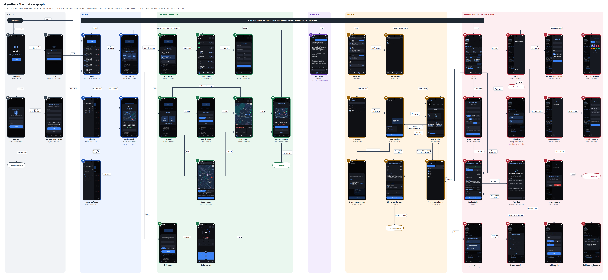
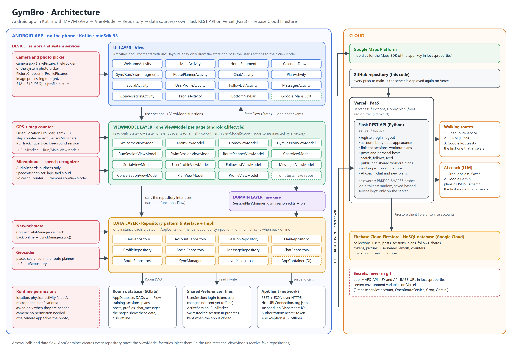

# GymBro

GymBro is an Android app for gym, running and swimming workouts. It has an AI coach that writes
workout plans and changes them on request, and a small social network where athletes share their
results and plans.

Project for the course **Mobile Applications and Cloud Computing**. Author: Filippo Tatafiore.

- **App**: Kotlin, XML views, MVVM, Room, coroutines and Flow, Google Maps. Android 13+ (minSdk 33).
- **Server**: own REST API in Python (Flask) on **Vercel** (PaaS), with the data in **Firebase
  Cloud Firestore**. See [server/README.md](server/README.md).

## Features

- **Training sessions**: start one from the home page (*start training*).
  - **Gym**: follow a day of the active workout plan, or train without a plan.
    - Add, edit and mark exercises as done.
    - Edits made during the session can also be saved into the plan.
  - **Run**:
    - Live map with the path followed, recorded by GPS even with the screen off.
    - Distance, pace, speed, calories and steps (step counter sensor).
    - Goal: a distance, or a route planned on the map (walking route through an optional stop).
  - **Swim**: pool length and a lap goal. Add laps with the buttons or **by voice**: say "GymBro",
    then the number of laps.
  - Pause and resume, then stop with a summary: save, or save and publish on the profile.
- **Home**: the last sessions and a monthly calendar of the training days.
- **AI coach**:
  - Chat about training.
  - Writes a gym plan from the goal, the level, the days, the minutes, the preferences and the body
    data.
  - Changes a plan when asked in the chat about that plan.
- **Workout plans**:
  - Edit them by hand, also offline.
  - Choose the active one.
  - Make them public, or share them with friends.
- **Social**:
  - Feed of the athletes you follow, with personal-best badges.
  - Search for athletes, see their public profiles, follow and unfollow, see the follower lists.
  - Copy the public plans of other athletes.
  - **Messages**: share plans with the athletes you follow and who follow you back.
- **Profile**:
  - Personal bests, workout plans and posts.
  - Publish a session, a result added manually or a plan.
  - Profile picture from the **camera** or the gallery.
  - Personal information.
  - Dark or light theme and an accent color, both saved in the account.
  - Change or delete the account.
- **Offline first**:
  - The home, the calendar, the profile, the plans and the chats also work offline.
  - Changes made offline are sent to the server as soon as the phone is back online.

## Navigation graph



The image is also available as a vector file:
[docs/navigation-graph.svg](docs/navigation-graph.svg).

How to read it:

- **Nodes**: the 43 screens and windows of the app. Each one shows its number, its name and the
  class that shows it.
- **Arrows**: each one is labeled with the action that opens the next screen.
- **Columns**: one per area of the app: access, home, training sessions, AI coach, social, profile
  and workout plans.
- **Bottom bar** (at the top of the graph): moves between the four main pages, 05 Home, 19 Chat,
  20 Social and 27 Profile.
- **Dashed tags**: the arrow continues at the screen with that number.
- **Not drawn**: Back, Cancel and closing a window, which all return to the previous screen.

## Architecture



The image is also available as a vector file: [docs/architecture.svg](docs/architecture.svg).

The app follows the architecture recommended for Android (MVVM, with data flowing in one
direction).

- **UI layer (View)**: Activities and Fragments with XML layouts.
  - They only draw the state of their ViewModel and pass the user's actions to it.
  - They collect the state with `repeatOnLifecycle`, so it is read only while the page is visible.
  - The bottom bar (`BottomNavBar`) moves between the four main pages: Home, Chat, Social and
    Profile.
- **ViewModel layer**: one ViewModel per page, in the [viewmodel](app/src/main/java/com/example/gymbro/viewmodel) package.
  - The state is a read-only `StateFlow`.
  - One-shot events, such as "plan saved" or "close the page", go through a `Channel`.
  - The work runs in `viewModelScope`, so the state survives when the page is recreated, for example
    after a change of theme.
- **Domain layer**: `SessionPlanChanges`, the use case that saves the edits of a gym session into
  the workout plan.
- **Data layer**: the Repository pattern, in the [repository](app/src/main/java/com/example/gymbro/repository) package.
  - Every repository is an interface plus its implementation (`XxxRepository` / `XxxRepositoryImpl`).
  - They are the only place where the pages read and change the data.
  - Their data sources:
    - the local **Room** database (`AppDatabase`, whose DAOs return `Flow`);
    - `SharedPreferences`, for the login and the session in progress;
    - `ApiClient`, the client of the REST API.
- **Dependency injection** (manual): [AppContainer.kt](app/src/main/java/com/example/gymbro/AppContainer.kt)
  creates every repository once, and the ViewModel factories receive them in the constructor. In the
  unit tests, the ViewModels receive fake repositories instead.
- **Offline first**:
  - The pages show the data saved on the phone.
  - A change is saved locally first, then sent to the server.
  - `SyncManager` sends the pending changes and downloads the new data. It runs when the app starts
    and every time the phone is back online (a `ConnectivityManager` callback).
  - `Notices` reports the result of the work done in the background as a toast, whichever page is
    open.
- **Concurrency**:
  - Coroutines everywhere: `Dispatchers.IO` for the network, `Dispatchers.Default` for image
    processing.
  - An application scope for work that must finish even if the page is closed, such as saving a
    session or a sync.
  - A **foreground service** (`RunTrackingService`) for the GPS and the steps of a run.
  - The microphone is read on a background coroutine.
- **Cloud**:
  - For its data, the app calls only our own REST API, over HTTPS with a Bearer token.
  - The server stores everything in Firestore and calls the routing services (OpenRouteService,
    OSRM, Google Routes) and the language models of the AI coach (Groq, then Google Gemini).
  - The API keys of these services stay on the server.
  - The maps are loaded by the Google Maps SDK.

Example: a run is stopped with **Save & publish**.

1. The stop window (`SessionFragment`, View) calls `MainViewModel.saveSession()` through
   `MainActivity`, which also stops the GPS service.
2. The ViewModel calls `SessionRepository.save()` in the application scope, so the save completes
   even if the page is closed.
3. The repository writes the session to Room, and the home page shows it at once through its `Flow`.
4. The repository sends the session to `POST /api/me/sessions`. Then `ProfileRepository` publishes
   it with `POST /api/me/posts`.
5. The Flask server, on Vercel, writes it to Firestore.
6. Offline, the session stays on the phone, marked as not sent, and `SyncManager` sends it when the
   phone is back online. It can then be published from LAST SESSIONS. `Notices` shows the result as
   a toast.

## Security and privacy

- **Passwords**: stored only as PBKDF2-SHA256 hashes.
- **Login tokens**:
  - Random, and stored on the server only as SHA-256 hashes.
  - Sent over HTTPS as a Bearer token.
  - A new password logs out the other phones.
- **Account deletion**: removes all the user's data: profile, picture, posts, sessions, workout
  plans, follows and shared plans.
- **AI coach**: receives the goal, the preferences and the body data (height, weight, BMI, age,
  sex), but never the username, the email or the password.
- **Body data**: only the user can see them.
- **Microphone**:
  - While waiting for a voice, the app only measures how loud the sound is.
  - Then the phone's speech recognizer listens for the number of laps.
  - Nothing is recorded or sent to the GymBro server.

## Project structure

```
GymBro/
├── app/src/main/java/com/example/gymbro/
│   ├── *Activity.kt      pages (UI layer): Welcome, Main, Chat, Social, UserProfile,
│   │                     FollowList, Messages, Conversation, Plan, Profile
│   ├── viewmodel/        one ViewModel per page
│   ├── repository/       repositories (interface + Impl), SyncManager, Notices
│   ├── data/             Room database: entities and DAOs
│   ├── network/          ApiClient (REST API), UserSession (login on the phone)
│   ├── home/             home page and calendar
│   ├── session/          gym, run and swim sessions: fragments, GPS service, route planner,
│   │                     trackers, voice lap counting, map drawing
│   ├── plan/             workout plans, SessionPlanChanges (use case)
│   ├── profile/          personal bests, posts, profile picture, personal information
│   ├── social/           lists of the social pages
│   ├── chat/             chat with the AI coach
│   ├── AppContainer.kt   dependency injection
│   └── GymBroApp.kt      Application: database, AppContainer, toasts of Notices
├── app/src/main/res/     XML layouts, drawables, strings, themes
├── app/src/test/         unit tests (JUnit), ViewModel tests with fake repositories
├── server/               Flask REST API (Vercel + Firestore), see server/README.md
└── docs/                 architecture graph and navigation graph
```

## Build and run

### Server

The server is already online on Vercel and deployed again on every push to GitHub.
[server/README.md](server/README.md) covers the following:

- the REST API: all 42 endpoints and their request bodies;
- the data in Firestore;
- the keys;
- the deployment on Vercel;
- how to run the server on your PC, with the online database or with the Firestore emulator.

### App

1. Open the project in **Android Studio** and let it sync Gradle.
2. Add these keys to `local.properties`, in the root folder. The file is not in git and the keys
   must never be committed.

   ```properties
   # Google Maps SDK for Android (Google Cloud console > APIs & Services > Credentials)
   MAPS_API_KEY=your-maps-api-key
   # The server online. Without it, the app uses the server on this PC (http://10.0.2.2:5000/ from the emulator)
   API_BASE_URL=https://your-project.vercel.app/
   ```

3. Run the app on a phone or emulator with **Android 13 or newer** and Google Play services. The
   maps and the GPS need Play services.

Permissions are asked only when they are needed:

- location: for a run;
- physical activity: for the steps;
- microphone: for the voice lap counting;
- notifications: for the run in progress.

The camera needs no permission, because the camera app of the phone takes the photo.

## Tests

```bash
./gradlew testDebugUnitTest
```

The unit tests in `app/src/test` cover the following:

- the logic of the app: run and swim math, GPS tracks, gym sessions, personal bests, body data,
  calendar, workout plans, chat formatting, spoken numbers, voice detection;
- the **ViewModels** (`viewmodel/` folder): with fake repositories that implement the same
  interfaces as the real ones, so no phone and no server are needed.
